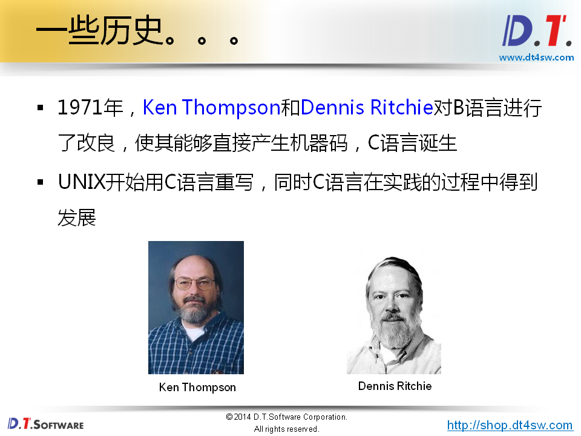
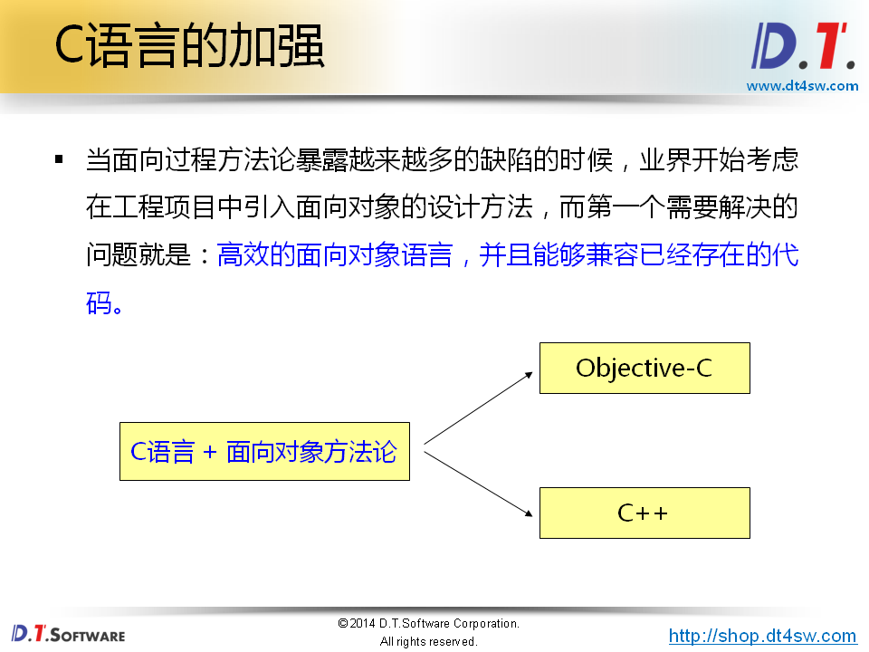
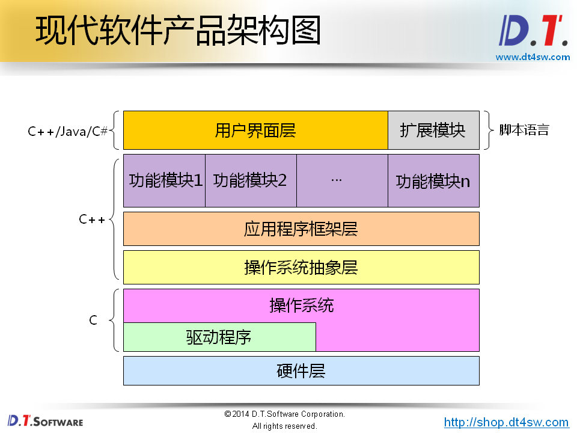
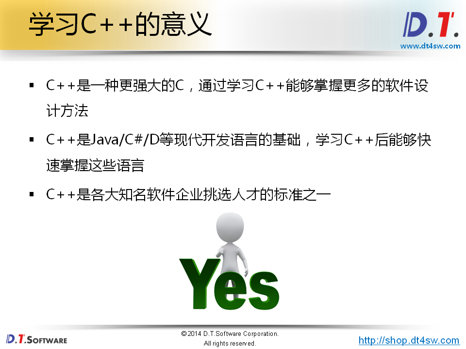

# 第 01 课：学习 C++ 的意义

- 课程：狄泰软件《C++ 深度解析》第 1 课
- 主题：为什么学 C++、C 与 C++ 的关系、C++ 在现代软件架构中的位置
- 整理日期：2026-11-14
- 课件：`images/slide-01.png` ～ `slide-17.png`
- 测试代码：原课程无；本仓库补充了 C/C++ 对照示例
- 截图目录：`images/`

## 学习目标

- 说清 C 与 C++ 的关系：继承、兼容、增强，而不是对立。
- 理解 C 语言的设计取舍：贴近硬件、执行高效，但抽象能力弱。
- 理解面向过程与面向对象两种方法论的区别。
- 知道 C++ 在现代软件产品各层中的位置。
- 能运行本仓库补充的 C / C++ 对照示例。

## 1. 常见观点与澄清

课件先列出了几种常见的“不用学 C++”的理由：

| 常见观点 | 更准确的理解 |
|---|---|
| 操作系统和驱动都是 C 写的，学好 C 就够了 | 内核/驱动确实以 C 为主，但应用框架、业务模块、UI 层大量使用 C++ |
| C++ 只在应用层用，嵌入式没必要学 | Qt、AUTOSAR Adaptive、机器视觉、运动控制上位机等都在用 C++ |
| Linus 说 C++ 一无是处 | 那是特定内核场景下的工程取舍，不代表 C++ 在其他领域没有价值 |
| 以后做驱动，没精力学 C++ | 驱动之上仍有大量框架和工具链是 C++；懂 C++ 能扩大可负责的模块范围 |

核心结论：

> **C 和 C++ 不是竞争关系。C++ 是 C 的加强，是一种“更好的 C”，并且完全兼容 C 的特性。**

## 2. 一点历史：C 为什么长这样



- UNIX 最初直接用汇编编写，开发效率是瓶颈。
- 1971 年，Ken Thompson 和 Dennis Ritchie 改良 B 语言，使其能直接产生机器码，C 语言诞生。
- UNIX 随后用 C 重写，C 也在实践中不断发展。

C 语言的特点（课件总结）：

- 是在实践中逐步完善起来的，**没有经过深思熟虑的完整设计**。
- 残留了较多低级语言特征。
- 设计目标是**高效**，首先是最终程序的执行效率。

这解释了 C 为什么“简单、贴近硬件”，也解释了它为什么缺少现代软件工程需要的抽象机制。

## 3. 软件方法论的发展

### 面向过程

- 核心：**数据结构 + 算法**
- 做法：分析解决问题的步骤 → 用函数实现每一步 → 依次调用。
- 适合：科学计算、需求简单且固定的场景。
- 问题：
  - 软件可重用性差；
  - 软件可维护性差；
  - 需求变化时改动面大。

### 面向对象

- 核心：**由现实世界建立软件模型**
- 做法：分析需求中的实体 → 在代码中描述实体 → 让实体协作解决问题。
- 优势：
  - 能适应需求的不断变化；
  - 在保留面向过程优势的同时，弥补其抽象能力不足。



当面向过程的缺陷越来越明显时，业界希望得到一种**既高效、又能兼容既有 C 代码**的面向对象语言。于是出现了两条路线：

- `C + 面向对象` → **Objective-C**
- `C + 面向对象` → **C++**

## 4. C++ 在现代软件架构中的位置



| 层次 | 主要语言 | 说明 |
|---|---|---|
| 用户界面层 / 扩展模块 | C++ / Java / C# / 脚本 | 直接面向用户和业务变化 |
| 功能模块层 | C++ | 数据库、网络、设备控制、更新等 |
| 应用程序框架层 | C++ | 领域框架、通用基础设施 |
| 操作系统抽象层 | C++ | 屏蔽平台差异，保证可移植性 |
| 操作系统 / 驱动程序 | C | 直接管理硬件与内核资源 |
| 硬件层 | — | CPU、外设、传感器、执行器 |

商场收银系统的例子（`slide-13.png`）也是同样的分层：UI 用 Java，业务模块和框架用 C/C++，底层是 Linux/Windows、驱动和硬件。

现代软件产品的特性：

- 系统通常由**多种语言**共同完成；
- 架构目标是**拥抱用户需求的变化**；
- 系统要有较好的**可移植性**；
- 系统要能方便地**部署和更新**；
- 操作系统的修改、驱动程序的开发在现代产品中的占比越来越小。

这也意味着：只会 C 能覆盖的只是最底层的一部分，越往上越需要 C++ 这样的抽象能力。

## 5. 学习 C++ 的意义



- C++ 是一种更强大的 C，学习它能掌握更多**软件设计方法**。
- C++ 是 Java、C#、D 等现代语言的基础，学好 C++ 后迁移成本更低。
- C++ 是很多知名软件企业选拔人才的标准之一。
- 对开发者：能胜任系统中任意一个模块的开发，是核心价值。
- 对架构师：掌握各种语言的优势并合理运用，简化系统开发，是核心价值。

## 6. 补充示例（非原课程测试代码）

> 说明：第 1 课是纯理论课，**原课程没有配套测试代码**。下面的示例是本仓库补充的，只用于直观感受 C 与 C++ 的写法差异，不属于原课程实验。

同一个加法程序，分别用 C 和 C++ 写一遍：

| 文件 | 说明 |
|---|---|
| [hello.c](code/demo01/hello.c) | C 版本：`printf` + 面向过程 |
| [hello.cpp](code/demo01/hello.cpp) | C++ 版本：`std::cout` + 更严格的类型检查 |

### 测试环境

| 项目 | 配置 |
|---|---|
| 操作系统 | Ubuntu 22.04 LTS（虚拟机） |
| C 编译器 | GCC 11.4.0（`/usr/bin/gcc`） |
| C++ 编译器 | G++ 11.4.0（`/usr/bin/g++`） |
| CMake | 3.22.1 |
| 生成器 | Ninja 1.10.1 |
| C 标准 | C11（`-std=c11`，关闭扩展） |
| C++ 标准 | C++17（`-std=c++17`，关闭扩展） |
| 构建类型 | Debug（`-g`，无优化） |
| 测试框架 | CTest |

### 编译运行

在仓库根目录：

```bash
cmake --preset debug
cmake --build --preset debug --target cpp01m_hello_c cpp01m_hello_cpp
ctest --preset debug -R cpp01m --output-on-failure
./build/debug/bin/cpp01m_hello_c
./build/debug/bin/cpp01m_hello_cpp
```

预期输出：

```text
C   : 10 + 20 = 30
C++ : 10 + 20 = 30
```

用 CLion / Gateway 打开仓库根目录，选择 `cpp01m_hello_c` 或 `cpp01m_hello_cpp` 直接运行即可。

## 7. 本课结论

1. C++ 继承了 C 的全部特性，并在其上增加抽象能力。
2. C 的目标是执行效率；C++ 的目标是**运行效率与开发效率的统一**。
3. 现代软件是分层的、多语言的：底层 C，框架和业务 C++，UI 可能是 Java/C#/脚本。
4. 学 C++ 不是抛弃 C，而是获得更多设计工具和更大的工程覆盖面。

## 8. 思考与练习

1. 为什么操作系统内核和驱动至今仍以 C 为主？C++ 在内核场景有哪些顾虑？
2. 找一个你熟悉的软件产品，画出它的分层架构，标出哪些层更可能用 C/C++。
3. 结合课件中的分层架构图，说明为什么“只学 C 就够了”在现代软件产品中不成立。
4. 用自己的话解释：为什么说“C++ 是一种更好的 C”，而不是“C++ 取代 C”。

## 附：课件索引

| 文件 | 内容 |
|---|---|
| `images/slide-01.png` | 课程封面 |
| `images/slide-02.png` | 常见观点 |
| `images/slide-03.png` | UNIX 与汇编 |
| `images/slide-04.png` | C 的诞生 |
| `images/slide-05.png` | C 语言的特点 |
| `images/slide-06.png` | 面向过程方法论 |
| `images/slide-07.png` | 面向对象方法论 |
| `images/slide-08.png` | C 的加强：Objective-C 与 C++ |
| `images/slide-09.png` | C 与 C++ 不是对立关系 |
| `images/slide-10.png` | 学习 C++ 的优势 |
| `images/slide-11.png` | 为什么要为其他语言做准备 |
| `images/slide-12.png` | 现代软件产品架构图 |
| `images/slide-13.png` | 商场收银系统架构图 |
| `images/slide-14.png` | 现代软件产品的特性 |
| `images/slide-15.png` | 学习 C++ 的意义 |
| `images/slide-16.png` | 小结 |
| `images/slide-17.png` | 联系方式 |
