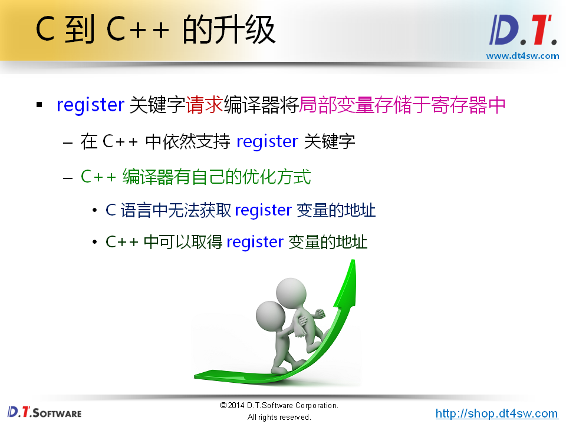
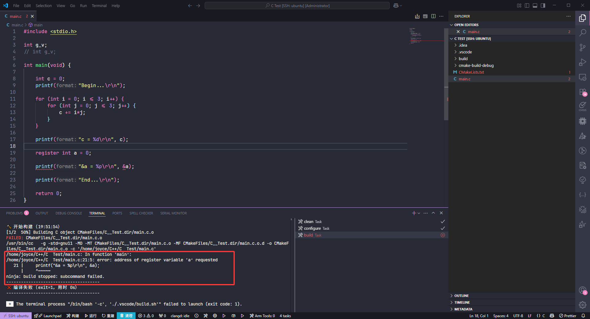
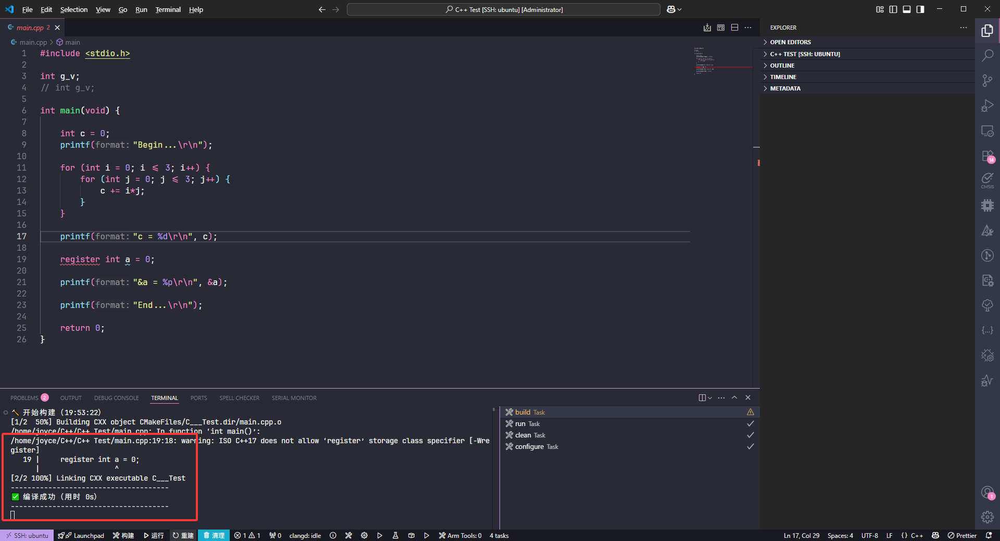
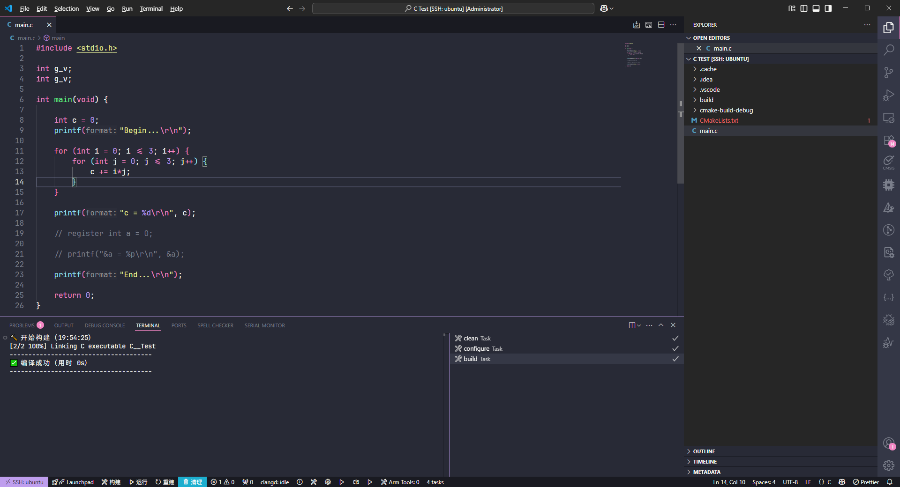
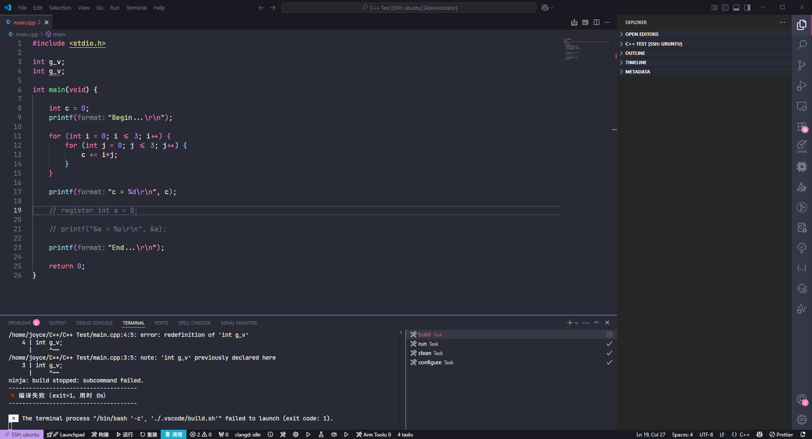
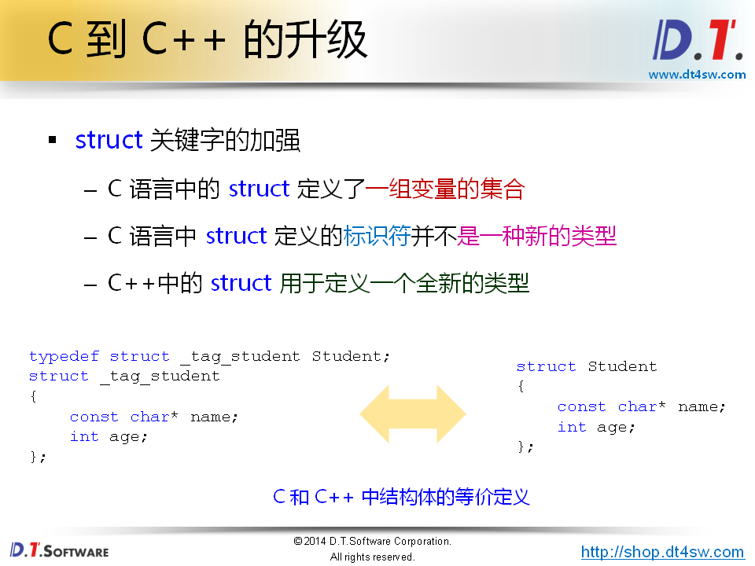
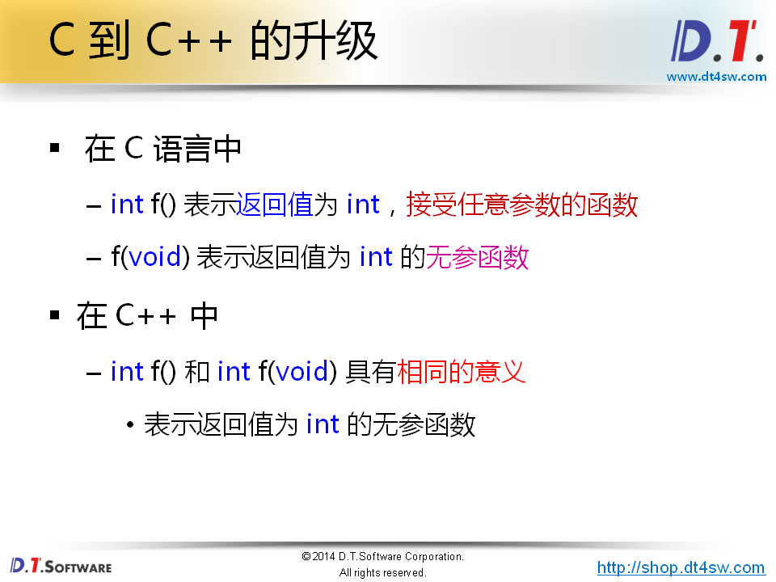

# 第 02 课：C 到 C++ 的升级

- 课程：狄泰软件《C++ 深度解析》第 2 课
- 主题：`register`、全局变量重定义、`struct`、函数声明与默认参数
- 整理日期：2026-11-14
- 课件：`images/slide-01.png` ～ `slide-14.png`
- 实机截图：`images/shot-01.png` ～ `shot-06.png`
- 测试代码：原课程提供，已整理为 `code/demo01` ～ `code/demo05`；原始片段在 `code/original/`
- 截图目录：`images/`

## 学习目标

- 理解 C++ 对 C 的兼容策略：保留语法，但语义更严格。
- 掌握 `register` 在 C 与 C++ 中的不同处理。
- 理解 C 的“试探性定义”和 C++ 的单一定义规则（ODR）。
- 掌握 `struct` 在 C 中是“标签”、在 C++ 中是“类型名”的区别。
- 分清 `int f()` 与 `int f(void)` 在两种语言中的含义。
- 了解 C++ 的默认参数，以及 C 中没有默认参数时怎么写。

## 0. 总览

| 主题 | C 的行为 | C++ 的行为 |
|---|---|---|
| 变量定义位置 | C89 要求放在语句块开头 | 可以在使用时再定义 |
| `register` 取地址 | 编译错误 | 允许，`register` 失效 |
| 重复定义全局变量 | 同一翻译单元内合法，合并 | 重定义错误 |
| `struct Student` | `Student` 不是类型名 | `Student` 就是类型名 |
| `int f()` | 参数未指定（旧式写法，编译器不检查实参） | 无参函数 |
| 隐式 `int` | 允许（旧式写法） | 非法，必须显式写类型 |
| 默认参数 | 不支持 | 支持 |

C++ 的设计目标不是“推翻 C”，而是**运行效率与开发效率的统一**：C 的特性尽量保留，容易产生歧义的用法则收紧。

## 1. 变量可以随用随定义

课件给出的对比：

```cpp
int c = 0;

for (int i = 1; i <= 3; i++)
{
    for (int j = 1; j <= 3; j++)
    {
        c += i * j;
    }
}
```

C++ 更强调实用性，变量可以在需要使用时再定义。课件中的 C 对比是 C89 的规定：**变量必须定义在作用域开始的位置**。

> 补充：C99 起也支持混合声明，所以这条差异在现代 C 中已经弱化；但“随用随定义、缩小作用域”依然是 C++ 更鼓励的写法。

## 2. `register` 关键字



`register` 的作用是**请求编译器把局部变量放到寄存器中**，以加快访问速度。

### C 中的 register

- `register` 变量不能取地址。
- 原因：寄存器没有内存地址，语言层面直接禁止。



```c
register int a = 0;
printf("&a = %p\n", &a);   // ❌ error: address of register variable 'a' requested
```

### C++ 中的 register

C++ 依然保留 `register` 关键字，但处理方式不同：

- C++ 编译器有自己的优化器，不再需要程序员用 `register` 提示。
- 当程序对 `register` 变量取地址时，`register` 的声明**自动失效**，变量按普通变量处理。
- 因此 C++ 中可以取得 `register` 变量的地址。



```cpp
register int a = 10;
int *p = &a;   // C++ 允许，register 失效
```

GCC 在 C++17 下会给出警告：

```text
warning: ISO C++17 does not allow 'register' storage class specifier [-Wregister]
```

> 结论：现代 C/C++ 中不要再用 `register`。它既不能保证变量真的进寄存器，C++17 起还已经被弃用/移除。把优化交给编译器。

### 示例

| 文件 | 说明 |
|---|---|
| [register.c](code/demo01/register.c) | 合法使用 `register`，把取地址语句注释掉 |
| [register.cpp](code/demo01/register.cpp) | 对 `register` 变量取地址，观察警告和运行结果 |

## 3. 全局变量的重复定义


### C：试探性定义

在 C 中，同一个翻译单元里可以出现多个同名的全局变量声明：

```c
int g_v;
int g_v;   // C 允许
```

这称为**试探性定义**（tentative definition）。链接时它们会被合并到全局数据区的同一个地址上。



### C++：单一定义规则

C++ 不允许同一个名字被定义多次：

```cpp
int g_v;
int g_v;   // ❌ error: redefinition of 'int g_v'
```



如果只是想在别的文件中使用这个变量，应该写声明而不是定义：

```cpp
extern int g_v;   // 声明
```

> 补充：GCC 10 起默认 `-fno-common`，跨翻译单元的重复定义也会报错。C 的“合并”仅适用于同一翻译单元内的试探性定义。

### 示例

| 文件 | 说明 |
|---|---|
| [global.c](code/demo02/global.c) | 两次 `int g_v;`，编译通过 |
| [global.cpp](code/demo02/global.cpp) | 只保留一次定义，注释中给出错误写法 |

## 4. `struct` 关键字



### C：struct 是“标签”

C 中 `struct Student` 定义的是一组变量的集合，`Student` 本身**不是类型名**：

```c
struct Student
{
    const char *name;
    int age;
};

struct Student s1 = {"John", 20};   // 必须带 struct
```

实际项目里通常配合 `typedef`：

```c
typedef struct Student Student;
Student s2 = {"Alice", 22};         // 有了别名才可以省略 struct
```

### C++：struct 是“类型”

C++ 中 `struct Student` 定义的是一个全新的类型，`Student` 可以直接作为类型名：

```cpp
struct Student
{
    const char *name;
    int age;
};

Student s1 = {"John", 20};          // 不需要 struct
```

> C++ 的 `struct` 与 `class` 几乎相同，唯一区别是默认访问权限：`struct` 默认 `public`，`class` 默认 `private`。

### 示例

| 文件 | 说明 |
|---|---|
| [struct.c](code/demo03/struct.c) | `struct Student` + `typedef` 两种写法 |
| [struct.cpp](code/demo03/struct.cpp) | 直接使用 `Student` |

## 5. 函数声明与隐式类型



### `int f()` 与 `int f(void)`

| 写法 | C | C++ |
|---|---|---|
| `int f()` | 参数**未指定**，可以传任意实参 | 无参函数 |
| `int f(void)` | 无参函数 | 无参函数 |

所以在 C 中：

```c
int f();        // 声明：参数待定
int f(void);    // 声明：明确无参
```

在 C++ 中两者完全等价：

```cpp
int f();        // 无参
int f(void);    // 无参
```

> 注意：课件说 C 的 `int f()` “接受任意参数”，指的是它**没有原型、编译器不检查实参个数**。如果函数定义本身是零参数，却传入了实参，标准上属于未定义行为；这里只是为了说明 C 与 C++ 在函数声明语义上的差异，不要在新代码中这样写。

### C 的隐式类型

旧式 C 允许省略返回类型和参数类型，默认都是 `int`：

```c
f(i)
{
    printf("i = %d\n", i);
}

g()
{
    return 5;
}
```

现代编译器会给出警告：

```text
warning: return type defaults to 'int' [-Wimplicit-int]
warning: type of 'i' defaults to 'int' [-Wimplicit-int]
```

C++ 不允许这种写法：**所有标识符都必须显式声明类型**。

### C++ 的默认参数

C++ 支持在函数声明中给参数默认值：

```cpp
int add(int a, int b = 10)
{
    return a + b;
}

add(5);      // 等价于 add(5, 10)
add(5, 3);   // 使用实参 3
```

C 没有默认参数，只能写两个函数，或者调用时把参数补全：

```c
int add_default(int a) { return a + 10; }
int add(int a, int b)  { return a + b; }
```

> 默认参数必须从右向左连续指定；调用时不能跳过中间的默认参数。

### 示例

| 文件 | 说明 |
|---|---|
| [function.c](code/demo04/function.c) | 隐式 `int`、`g()` 无原型（不检查实参个数） |
| [function.cpp](code/demo04/function.cpp) | 显式类型，注释中给出 C 风格写法的报错 |
| [default_args.c](code/demo05/default_args.c) | C 中用两个函数模拟默认参数 |
| [default_args.cpp](code/demo05/default_args.cpp) | C++ 默认参数 |

## 6. 原始测试片段

桌面 `lesson_02` 里的原始练习保留在 `code/original/`：

| 文件 | 内容 |
|---|---|
| [test_1.txt](code/original/test_1.txt) | 双重循环求和 + 注释掉的 `register` 取地址实验 |
| [test_2.txt](code/original/test_2.txt) | `struct Student` + 旧式函数 `f(i)` / `g()` + 默认参数实验 |

这些片段是课堂手写练习，直接编译会包含故意留下的错误；整理后的可编译版本见 `code/demo01/` ～ `code/demo05/`。

## 7. 常见面试题

1. `int f()` 和 `int f(void)` 有区别吗？
   - C：有。`f()` 的参数未指定，`f(void)` 明确无参。
   - C++：没有区别，都表示无参。
2. 为什么 C 允许重复定义全局变量，C++ 不允许？
   - C 的试探性定义会在链接时合并；C++ 遵循单一定义规则，避免歧义。
3. 为什么 C 不能对 `register` 变量取地址，C++ 可以？
   - C 中 `register` 是硬性存储建议，寄存器无地址；C++ 中取地址会让 `register` 失效。
4. C 中如何省略 `struct` 关键字？
   - 用 `typedef struct Student Student;` 起别名。
5. C 如何模拟默认参数？
   - 写多个函数重载（不同名字）、用宏，或调用时补全参数；C 没有真正的默认参数。

## 8. 编译运行

### 测试环境（已验证）

| 项目 | 配置 |
|---|---|
| 操作系统 | Ubuntu 22.04 LTS（虚拟机） |
| C 编译器 | GCC 11.4.0（`/usr/bin/gcc`） |
| C++ 编译器 | G++ 11.4.0（`/usr/bin/g++`） |
| CMake | 3.22.1 |
| 生成器 | Ninja 1.10.1 |
| C 标准 | C11（`-std=c11`，关闭扩展） |
| C++ 标准 | C++17（`-std=c++17`，关闭扩展） |
| 警告选项 | `-Wall -Wextra -Wpedantic` |
| 构建类型 | Debug（`-g`，无优化） |
| 测试框架 | CTest |
| 验证日期 | 2026-11-14 |

复现环境信息：

```bash
gcc --version | head -1
g++ --version | head -1
cmake --version | head -1
ninja --version
```

本机实测结果：

```text
gcc (Ubuntu 11.4.0-1ubuntu1~22.04) 11.4.0
g++ (Ubuntu 11.4.0-1ubuntu1~22.04) 11.4.0
cmake version 3.22.1
1.10.1
```

在仓库根目录：

```bash
cmake --preset debug
cmake --build --preset debug
ctest --preset debug --output-on-failure
```

只跑某一组：

```bash
cmake --build --preset debug --target cpp02u_register_c cpp02u_register_cpp
./build/debug/bin/cpp02u_register_c
./build/debug/bin/cpp02u_register_cpp
```

预期输出示例：

```text
C: a = 10
C++: a = 10, *p = 10, &a = 0x7ffd...
C: g_v = 42, &g_v = 0x...
C++: g_v = 42, &g_v = 0x...
C:   John, 20
C++: John, 20
C: f: i = 10
C: g(1,2,3,4,5) = 5
C++: f: i = 10
C++: g() = 5
C: add_default(5) = 15
C: add(5, 3)      = 8
C++: add(5)    = 15
C++: add(5, 3) = 8
```

> C 版本会带一些 `-Wimplicit-int` 警告，这是故意保留的，用来说明旧式 C 的写法。C++ 版本的 `register` 会带 `-Wregister` 警告。

### 本课验证结果

- 10 个 target 全部构建成功。
- 10 个 CTest 用例全部通过。
- 预期警告（不是错误）：
  - `function.c`：`-Wimplicit-int`、`-Wreturn-type`，对应旧式 C 的隐式 `int`。
  - `register.cpp`：`-Wregister`、`-Wextra`，对应 C++ 中对 `register` 变量取地址。
- 整仓 23 个测试用例全部通过（`ctest --preset debug`）。

## 9. 小结

- C++ 保留了 C 的语法，但收紧了容易产生歧义的语义。
- `register` 在 C++ 中只是兼容符号，取地址后失效；C++17 起已弃用。
- 全局变量：C 允许试探性定义并合并，C++ 遵循单一定义规则。
- `struct`：C 是标签，C++ 是类型名。
- 函数：C 的 `f()` 参数未指定，C++ 的 `f()` 是无参；C++ 还支持默认参数。
- C++ 要求所有标识符显式声明类型，不再支持隐式 `int`。

## 10. 练习

1. 把 `register.c` 中的取地址语句取消注释，确认 C 的报错信息。
2. 把 `global.cpp` 的第二次定义取消注释，确认 C++ 的报错信息。
3. 在 `struct.c` 中去掉 `typedef`，只保留 `struct Student`，观察哪些写法会失败。
4. 写一个 C++ 函数 `int max(int a, int b = 0, int c = 0)`，测试不同调用方式。
5. 用 C 写一个“默认参数”版本：分别实现 `add1`、`add2`、`add3`，比较代码量。

## 附：课件与截图索引

| 文件 | 内容 |
|---|---|
| `images/slide-01.png` | 课程封面 |
| `images/slide-02.png` | C 与 C++ 的关系 |
| `images/slide-03.png` | 变量随用随定义 |
| `images/slide-04.png` | register 关键字 |
| `images/slide-05.png` | C++ 中 register 取地址后失效 |
| `images/slide-06.png` | 全局变量重复定义 |
| `images/slide-07.png` | 实例分析 2-1.cpp |
| `images/slide-08.png` | struct 关键字加强 |
| `images/slide-09.png` | 思考：int f() 与 int f(void) |
| `images/slide-10.png` | C 的隐式类型 |
| `images/slide-11.png` | f() 与 f(void) 的区别 |
| `images/slide-12.png` | 实例分析 2-2.cpp |
| `images/slide-13.png` | 小结 |
| `images/slide-14.png` | 联系方式 |
| `images/shot-01-cpp-register.png` | C++ 对 register 取地址（仅警告） |
| `images/shot-02-cpp-global-redefinition.png` | C++ 全局变量重定义报错 |
| `images/shot-03-c-register-error.png` | C 对 register 取地址报错 |
| `images/shot-04-c-global-duplicate.png` | C 重复定义全局变量通过 |
| `images/shot-05-struct-diff.png` | C/C++ struct 用法对比 |
| `images/shot-06-implicit-type-diff.png` | C/C++ 隐式类型对比 |
