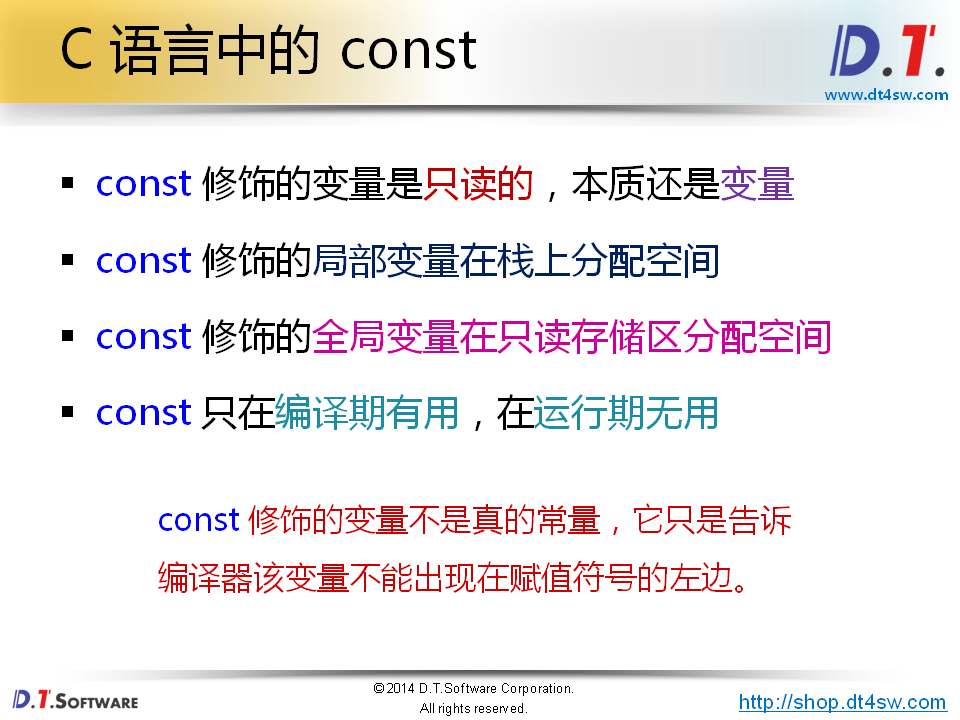
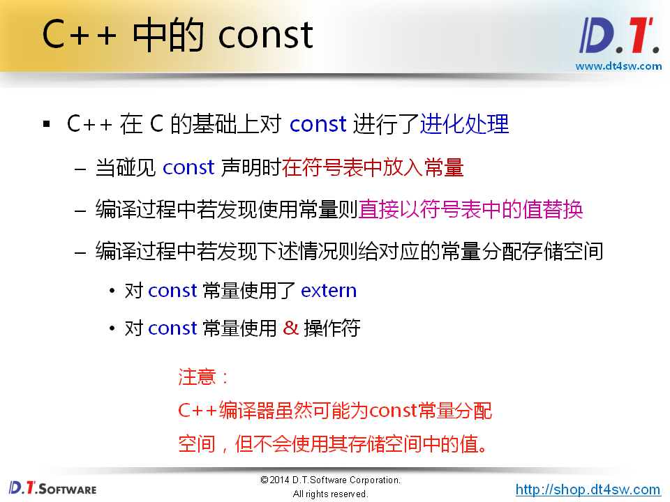
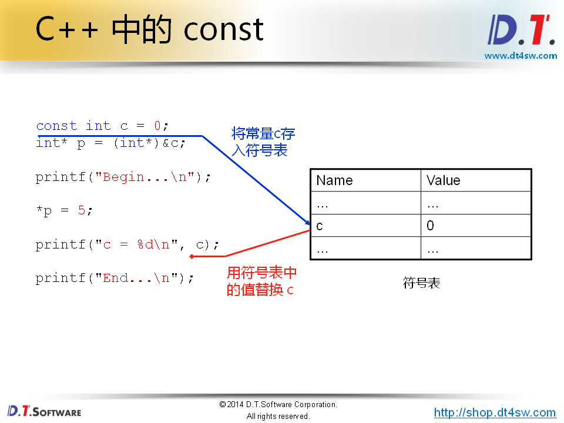
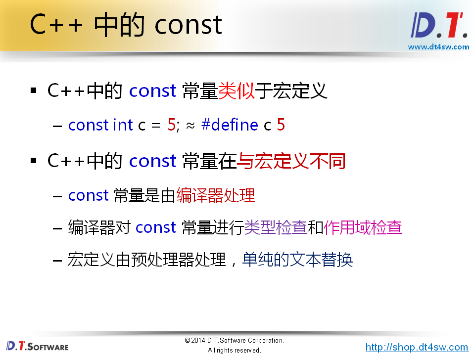
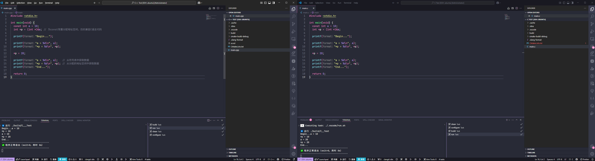
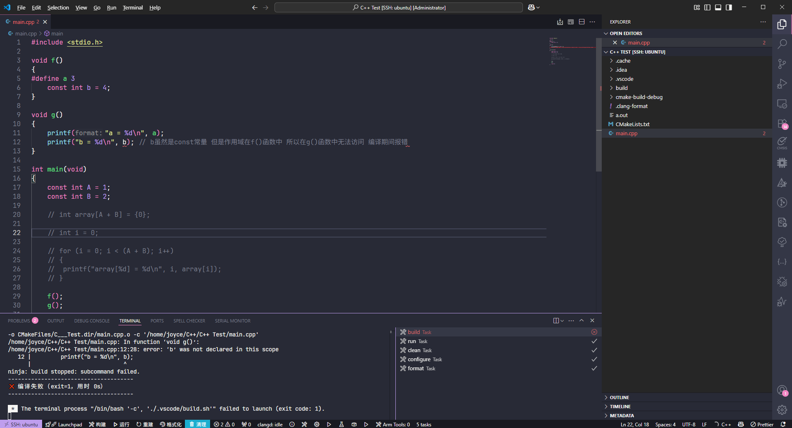
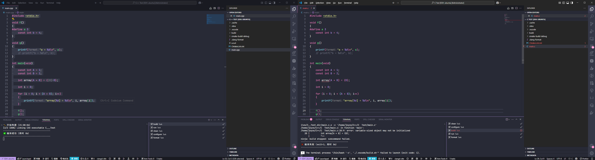
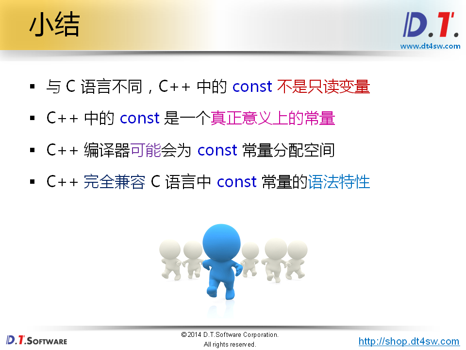

# 第 03 课：进化后的 const 分析

- 课程：狄泰软件《C++ 深度解析》第 3 课
- 主题：C 与 C++ 中 `const` 的本质差异
- 整理日期：2026-11-14
- 课件：`images/slide-01.png` ～ `slide-11.png`
- 实机截图：`images/shot-01.png` ～ `shot-03.png`
- 测试代码：原课程提供，已整理为 `code/demo01` ～ `code/demo03`；原始片段在 `code/original/`
- 截图目录：`images/`

## 学习目标

- 理解 C 的 `const` 只是“只读变量”，不是真正的常量。
- 理解 C++ 的 `const` 是“真正常量”，以及符号表替换机制。
- 知道 C++ 在什么情况下会为 `const` 分配存储空间。
- 掌握 `const` 与 `#define` 的区别。
- 能解释为什么 C 不能用 `const` 变量定义数组长度，而 C++ 可以。

## 1. C 语言中的 const



课件总结的 C `const` 特点：

- `const` 修饰的变量是**只读的**，本质还是变量。
- `const` 修饰的局部变量在**栈上分配空间**。
- `const` 修饰的全局变量在**只读存储区**分配空间。
- `const` **只在编译期有用**，运行期无用。

关键一句话：

> C 的 `const` 不是真正的常量，它只是告诉编译器：这个变量不能出现在赋值符号的左边。

也就是说：

```c
const int a = 10;
a = 20;          // ❌ 编译期报错
*(int *)&a = 20; // 能绕过编译检查（属于未定义行为）
```

因为 C 的 `const` 变量仍然有存储空间，运行时仍然从内存取值，所以通过指针修改后，再读 `a` 会看到新值。

### C 中 const 不能定义数组长度

```c
const int A = 1;
const int B = 2;
int array[A + B] = {0};   // ❌ C 中 A + B 不是常量表达式
```

C 的数组长度要求是整型常量表达式，而 `const` 变量不是常量表达式。C99 的变长数组（VLA）也不是“常量长度”，且不能初始化。

C 的替代方案：

```c
enum { A = 1, B = 2 };
int array[A + B] = {0};
```

或者使用宏：

```c
#define A 1
#define B 2
```

## 2. C++ 中的 const



C++ 在 C 的基础上对 `const` 做了“进化”：

- 遇到 `const` 声明时，把常量放入**符号表**。
- 编译过程中如果使用该常量，**直接用符号表中的值替换**。
- 只有在以下情况才为常量分配存储空间：
  - 对 `const` 常量使用了 `extern`；
  - 对 `const` 常量使用了 `&` 取地址。
- 即使分配了空间，编译器也**不会使用该存储空间中的值**，仍然使用符号表中的值。



```cpp
const int c = 0;
int *p = (int *)&c;   // 取地址，编译器为 c 分配空间

*p = 5;               // 修改的是存储空间

printf("c = %d\n", c); // 仍然输出 0：使用符号表中的值
```

> 注意：通过指针修改 `const` 对象属于**未定义行为**。这里的实验只是用来观察编译器的实现方式，实际代码中不要这样做。

### C++ 中 const 是真正的常量

因为 `const` 是常量表达式，所以可以直接定义数组：

```cpp
const int A = 1;
const int B = 2;
int array[A + B] = {0};   // ✅ C++ 合法
```

### const 与宏的区别



| 对比项 | `const` 常量 | `#define` 宏 |
|---|---|---|
| 处理阶段 | 编译器 | 预处理器 |
| 本质 | 有类型的常量 | 纯文本替换 |
| 类型检查 | 有 | 无 |
| 作用域检查 | 有 | 无（从定义点到文件末尾） |
| 调试信息 | 有 | 通常没有 |
| 是否可作为数组长度 | C++ 可以 | 可以 |

`#define` 不理会函数作用域：

```cpp
void f()
{
#define A 3
    const int b = 4;
}

void g()
{
    printf("%d\n", A);   // ✅ 宏仍然有效
    // printf("%d\n", b); // ❌ b 的作用域只在 f()
}
```

课件里的实验 3-2.cpp 就是用来演示这一点的。

## 3. 三个实验

### 实验一：取地址后修改 const

| 文件 | 语言 | 预期结果 |
|---|---|---|
| [const_address.c](code/demo01/const_address.c) | C | `a = 20, *p = 20` |
| [const_address.cpp](code/demo01/const_address.cpp) | C++ | `a = 10, *p = 20` |



C 版本：

```text
C: a = 10, *p = 10
C: a = 20, *p = 20
```

C++ 版本：

```text
C++: a = 10, *p = 10
C++: a = 10, *p = 20
```

差异的原因：

- C：`a` 是只读变量，读取时访问内存，内存已被改成 20。
- C++：`a` 是真常量，读取时直接用符号表中的 10，指针改的是另一块存储空间。

### 实验二：const 与宏的作用域

| 文件 | 说明 |
|---|---|
| [const_macro.c](code/demo02/const_macro.c) | C 版本，宏 `A` 泄漏到 `g()` |
| [const_macro.cpp](code/demo02/const_macro.cpp) | C++ 版本，`const b` 不能跨函数访问 |



如果把 `g()` 中访问 `b` 的语句取消注释：

```text
error: 'b' was not declared in this scope
```

而 `A` 仍然可以访问，因为预处理阶段已经把 `A` 替换成 `3`，预处理器根本不认识函数作用域。

### 实验三：const 作为数组长度

| 文件 | 语言 | 结果 |
|---|---|---|
| [const_array.c](code/demo03/const_array.c) | C | `const` 版本编译失败，改用 `enum` |
| [const_array.cpp](code/demo03/const_array.cpp) | C++ | 编译通过 |



C 的报错：

```text
error: variable-sized object may not be initialized
```

C++ 则把 `A + B` 当作常量表达式，数组大小在编译期确定。

## 4. 原始测试片段

桌面 `lesson_03` 里的原始练习保留在 `code/original/`：

| 文件 | 内容 |
|---|---|
| [test_1.txt](code/original/test_1.txt) | 空文件（占位） |
| [test_2.txt](code/original/test_2.txt) | `#define` / `const` 作用域实验 + 注释掉的 const 数组实验 |

整理后的可编译版本见 `code/demo01/` ～ `code/demo03/`。

## 5. 小结



- 与 C 不同，C++ 中的 `const` **不是只读变量**，而是**真正意义上的常量**。
- C++ 编译器可能会为 `const` 常量分配空间，但读取时仍然使用符号表中的值。
- C++ 完全兼容 C 中 `const` 的语法特性。
- C 的 `const` 只在编译期阻止赋值，运行期仍可通过指针绕过（未定义行为）。
- C++ 的 `const` 参与常量表达式，可以用于数组长度、模板参数等场景。

## 6. 易错点

1. **不要通过指针修改 `const` 对象。**
   无论在 C 还是 C++ 中，这都是未定义行为。实验结果依赖编译器和优化级别，不能作为可移植代码。

2. **C++ 中全局 `const` 默认是内部链接。**
   如果希望在其他翻译单元中使用，需要写 `extern const int value = 10;`，这也是课件所说“使用 `extern` 会分配存储空间”的场景之一。

3. **`const` 与 `volatile` 可以同时使用。**
   例如只读硬件寄存器：`const volatile uint32_t *reg`，既禁止程序写，又要求每次都从内存读取。

4. **`#define` 没有作用域。**
   在函数体内写 `#define` 并不会把宏限制在函数内，容易污染后面的代码。C++ 中优先用 `const` / `constexpr`。

5. **C 的 `const` 变量不是常量表达式。**
   文件作用域和块作用域都一样，不能直接用于数组长度、`case` 标签等需要常量表达式的位置。

## 7. 编译运行

### 测试环境（已验证）

| 项目 | 配置 |
|---|---|
| 操作系统 | Ubuntu 22.04 LTS（虚拟机） |
| C 编译器 | GCC 11.4.0（`/usr/bin/gcc`） |
| C++ 编译器 | G++ 11.4.0（`/usr/bin/g++`） |
| CMake | 3.22.1 |
| 生成器 | Ninja 1.10.1 |
| C 标准 | C11（`-std=c11`，关闭扩展） |
| C++ 标准 | C++17（`-std=c++17`，关闭扩展） |
| 警告选项 | `-Wall -Wextra -Wpedantic` |
| 构建类型 | Debug（`-g`，无优化） |
| 测试框架 | CTest |
| 验证日期 | 2026-11-14 |

复现环境信息：

```bash
gcc --version | head -1
g++ --version | head -1
cmake --version | head -1
ninja --version
```

在仓库根目录：

```bash
cmake --preset debug
cmake --build --preset debug
ctest --preset debug --output-on-failure
```

只跑本课：

```bash
cmake --build --preset debug --target cpp03c_const_address_c cpp03c_const_address_cpp
./build/debug/bin/cpp03c_const_address_c
./build/debug/bin/cpp03c_const_address_cpp
```

其他目标：

```bash
./build/debug/bin/cpp03c_const_macro_c
./build/debug/bin/cpp03c_const_macro_cpp
./build/debug/bin/cpp03c_const_array_c
./build/debug/bin/cpp03c_const_array_cpp
```

### 本课验证结果

- 6 个 target 全部构建成功。
- 6 个 CTest 用例全部通过。
- 关键输出已验证：
  - `const_address_c`：第二次输出 `a = 20, *p = 20`。
  - `const_address_cpp`：第二次输出 `a = 10, *p = 20`。
  - `const_macro_c/cpp`：`g()` 中 `A = 3`，`b` 不可访问。
  - `const_array_c/cpp`：C 用 `enum` 替代，C++ 直接用 `const`。
- 整仓 23 个测试用例全部通过（`ctest --preset debug`）。

## 8. 练习

1. 把 `const_address.cpp` 的编译选项改成 `-O2`，观察输出是否变化，并解释原因。
2. 在 `const_macro.cpp` 中把 `#define A 3` 移到文件开头，观察 `g()` 的输出。
3. 用 `constexpr` 重写 `const_array.cpp`，比较两者的语义。
4. 写一个函数 `void print(const int *p)`，尝试在函数内修改 `*p`，观察编译错误。
5. 解释：为什么 C++ 明明为 `const` 常量分配了空间，读取时却不用那块空间？

## 附：课件与截图索引

| 文件 | 内容 |
|---|---|
| `images/slide-01.png` | 课程封面 |
| `images/slide-02.png` | C 语言中的 const |
| `images/slide-03.png` | const 不能定义真正的常量 |
| `images/slide-04.png` | 编程实验 3-1.cpp |
| `images/slide-05.png` | C++ 中的 const：符号表 |
| `images/slide-06.png` | 符号表替换示意 |
| `images/slide-07.png` | 何时为 const 分配空间 |
| `images/slide-08.png` | const 与宏的对比 |
| `images/slide-09.png` | 编程实验 3-2.cpp |
| `images/slide-10.png` | 小结 |
| `images/slide-11.png` | 联系方式 |
| `images/shot-01-const-macro-scope.png` | 宏泄漏 / const 作用域报错 |
| `images/shot-02-const-array-c-error.png` | C 中用 const 定义数组报错 |
| `images/shot-03-const-address-output.png` | C/C++ const 取地址运行结果 |
